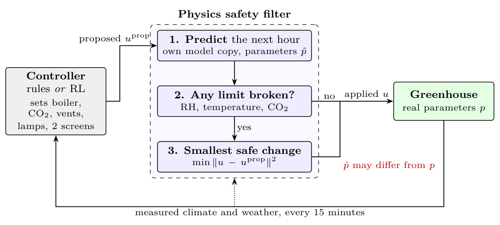

# Greenhouse safety filter

Code, frozen results and figure scripts for the workshop paper *Separating Safety from Profit: A
Predictive Safety Filter for Greenhouse Climate Control* (2026), built on
[GreenLight-Gym](https://github.com/BartvLaatum/GreenLight-Gym2) (gl_gym 0.3.2).

**Paper:** [PDF](https://aarmens702-hub.github.io/greenhouse-safety-filter/Sidhu_2026_safety_filter.pdf)
(under review at the AAAI-27 Workshop on AI in Agriculture).



## How the filter works

- Every 15 minutes a controller, either tuned rules or a PPO-Lagrangian RL agent, proposes six
  actuator settings: boiler, CO2 dosing, thermal screen, vents, lamps and blackout screen.
- The filter simulates the next hour (4 steps) on its own copy of the greenhouse model, holding that
  action.
- If the forecast stays inside margins just within the limits (limits RH 50-85%, temperature
  15-34 °C, CO2 300-1600 ppm; margins RH 84%, 15.5/33.5 °C, 320/1580 ppm), the action passes
  unchanged.
- Otherwise a coordinate search (steps of ±0.1, 0.25 and 0.5; vents, boiler, thermal screen,
  blackout screen, lamps, CO2; two passes) picks the action minimising
  1000 × predicted violation + ‖u − ũ_t‖², where ũ_t is the controller's proposal (`u_prop` in the
  code).
- The filter gives no formal guarantee: the search is approximate and it looks only one hour ahead.

## Main results

Simulated and exploratory; 60-day seasons, mean of 6 seasons, RL mean of 3 seeds.

- Violation hours per season: rules 380 → 42 with the filter; RL 84 → 5.
- At fruit €2.50/kg and challenge energy prices, RL + filter earns €4.93/m² more than rules + filter
  (SD 0.45 over seeds, ahead in 18 of 18 season-seed pairs); break-even fruit price €1.19/kg
  (€1.68/kg at Dutch energy prices).
- Model accuracy: on a greenhouse with fitted parameters, a filter using the default model is worse
  than no filter; getting the greenhouse geometry right matters most.

## Layout

```
safety_filter/    the filter (filter.py) and one-season runners (run_season.py, run_season_calib.py)
greenleaf_core/   env, reward, grader and PPO setup on top of gl_gym (subset of the author's earlier repo)
controllers/      tuned rules (rules.py, configs/) and PPO-Lagrangian training, scoring and queue
experiments/      the run queues behind each result (main comparison and mismatch, new seasons, calibration)
results/          frozen result rows, numbers.json and paper_numbers.py, which rebuilds it
figures/          figure and table scripts; outputs in figures/out/, Figure 2 trace data in figures/data/
data/             Wageningen 2020 weather (Autonomous Greenhouse Challenge, CC0)
docs/             FROZEN.md (hashes of the frozen files) and the pre-registration notes
models/           empty; the trained agents go here (see models/README.md)
tests/            smoke test
```

## Install

Python 3.12.

```
python3.12 -m venv .venv && source .venv/bin/activate
pip install -r requirements.txt
python tests/smoke_test.py          # a few seconds: one filter call and one filtered step
```

`requirements.txt` pins the versions every result was produced with; gl_gym is installed from
GreenLight-Gym2 on GitHub at commit 2d3febb. Scripts run from any directory. The simulations are
single-threaded; the results were produced with `OMP_NUM_THREADS=1`.

## Reproduce the paper's numbers, table and figures (from the frozen results)

| Output | Command | Time |
|---|---|---|
| All numbers (`results/numbers.json`) | `python results/paper_numbers.py` | 1 s |
| Table 1 | `python figures/table1.py` | seconds |
| Figure 1 | `tectonic -X compile figures/fig1_system.tex --outdir figures/out` (or pdflatex) | seconds |
| Figure 2 | `python figures/fig2_in_action.py` | seconds |
| Figure 3 | `python figures/fig3_performance.py` | seconds |
| Figure 4 | `python figures/fig4_calibration.py` | seconds |

`paper_numbers.py` overwrites `results/numbers.json`; the file must stay byte-identical
(`git diff` shows nothing; sha256 in `docs/FROZEN.md`). Pass a path to write elsewhere.

## Rerun the experiments

New rows go to `outputs/` (not tracked) so the frozen files are never touched; compare them with
`results/`. Every queue resumes where it stopped. Times are for one core; the first argument is the
number of parallel workers.

1. Agents. Download the six trained agents from the GitHub release into `models/` (see
   `models/README.md`), or train them: `python controllers/run_ppolag.py WORKERS` trains the
   paper's six agents plus three exploratory ones (2M steps each, about 70 minutes per agent on one laptop core, so hours
   in total) and scores each unfiltered on the 6 original seasons, default parameters and mismatch
   (`results/ppolag/scores.jsonl`; seconds per season). One agent:
   `python controllers/train_ppolag.py 0 0.01 --price agc25`.
2. Main comparison and model mismatch (Table 1, Figure 3, T4, T4b, T7):
   `python experiments/main_comparison.py WORKERS` - 96 seasons, 72 of them filtered at 1-20 min each
   (about 12 h on one core).
3. Six new seasons (T6, pre-registered): `python experiments/more_seasons.py WORKERS` - 48 seasons,
   about 6 h.
4. Calibration study (Figure 4, T2, T3), sim-tuned rules on Bie et al.'s calibrated greenhouse:
   - baselines: `python experiments/calibration_baselines.py WORKERS` (18 seasons, about 4 h)
   - model blend 0-100%: `python experiments/calibration_blend.py WORKERS` (16 seasons, about 5 h)
   - parameter groups: `python experiments/calibration_groups.py WORKERS` and `... --check`
     (13 seasons, about 4 h)
   - sensor-noise check: `bash experiments/calibration_noise.sh` (3 seasons, about 1 h)
5. Figure 2 trace: `python figures/fig2_trace.py raw` and `python figures/fig2_trace.py filter`
   (seconds and about 10 minutes).

A single season: `python -m safety_filter.run_season --ctrl rb_tuned_agc2020 --loc Amsterdam
--year 2010 --start 59 --limit 85 --h 4 --obj mindev --out outputs/one.jsonl` (`--help` for options).
The simulator is deterministic: rerunning a season with the same versions gives the same row
apart from timing fields.

Not in this repository: the rule-tuning code (the two tuned parameter sets are in
`controllers/configs/`), the script that converted the challenge weather to gl_gym's format, and the
earlier residual-RL and PPO agents whose rows appear in T1 and T2 of `numbers.json` but not in the
paper (see `results/README.md`).

## How the numbers are frozen

Every scored number in the paper comes from `results/numbers.json`, built only by
`results/paper_numbers.py` from the raw rows in `results/` (Figure 2's illustrative counts come from
its trace in `figures/data/`, which is checked against the frozen rows). `docs/FROZEN.md` records the sha256 of
numbers.json, the script and each raw file at the time of freezing (2026-11-06), and dated notes for
anything after. The figure and table scripts check those hashes on every load and assert that
recomputed totals equal numbers.json. `docs/preregistration_filter.md` and
`docs/preregistration_ppolag.md` are the dated plans, each written before the runs it describes,
with every later change and its reason. All results are exploratory: they reuse evaluation seasons,
and no sealed test weather was used.

## Data and licences

- Code in this repository: AGPL-3.0-or-later (`LICENSE`), matching gl_gym and the greenleaf-dashboard code it reuses.
- GreenLight-Gym2 / gl_gym 0.3.2 (van Laatum, van Henten and Boersma), installed as a dependency,
  AGPL-3.0-or-later. Its bundled Amsterdam 2008-2011 weather is read from the installed package, not
  copied. `greenleaf_core/configs/ppo.yml` is an unmodified copy of its PPO settings and keeps its
  AGPL-3.0-or-later licence.
- `greenleaf_core/` and `controllers/rules.py` come from the author's earlier repository
  greenleaf-dashboard (AGPL-3.0-or-later there).
- Wageningen 2020 weather (`data/weather/Wag/2020.csv`): Autonomous Greenhouse Challenge, Second
  Edition (2019), Hemming et al., 4TU.ResearchData, doi:10.4121/uuid:88d22c60-21b3-4ea8-90db-20249a5be2a7,
  CC0. Provenance in `data/README.md`.
- Calibrated greenhouse parameters from Bie, Xu and Wang (2026), arXiv:2607.11959.
- The PPO-Lagrangian follows SafeGreenRL (Sharma and Mourya, SSRN 6989405); the implementation is our own.

## Citation

If you use this code, please cite the paper and GreenLight-Gym
(van Laatum, van Henten and Boersma, 2025). `CITATION.cff` holds the software citation.

```bibtex
@misc{sidhu2026safetyfilter,
  author = {Sidhu, Aarmen},
  title  = {Separating Safety from Profit: A Predictive Safety Filter for Greenhouse Climate Control},
  note   = {Under review at the AAAI-27 Workshop on AI in Agriculture},
  year   = {2026},
  url    = {https://aarmens702-hub.github.io/greenhouse-safety-filter/}
}
```
