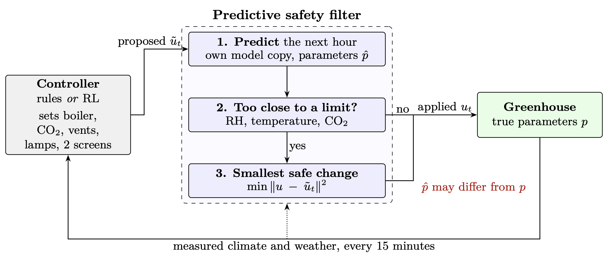

# Separating Safety from Profit: A Predictive Safety Filter for Greenhouse Climate Control

Aarmen Sidhu, Simon Fraser University

Under review at the AAAI-27 Workshop on AI in Agriculture (Agri AI), Montréal, 2027.

**[Paper (PDF)](Sidhu_2026_safety_filter.pdf)** · **[Code](https://github.com/aarmens702-hub/greenhouse-safety-filter)**



## Abstract

Greenhouse controllers must earn a profit while keeping humidity, temperature and CO₂ within crop limits. Reinforcement learning (RL) can earn more than tuned rules, but safety constraints applied during training cap violations only on average, so a trained agent still breaks the limits. We place a predictive safety filter between the controller and the greenhouse. Using its own physics model of the greenhouse, it forecasts the next hour and changes the proposed action only when the forecast comes too close to a limit. In simulation with GreenLight-Gym, the filter cut violations from 84 to 5 hours per season for an RL agent and from 380 to 42 hours for tuned rules. With safety handled, RL earned €4.93/m² more per season than the rules at a fruit price of €2.50/kg. Its lead held whenever fruit sold above a break-even price of €1.19 to €1.68/kg, depending on energy prices. When the simulated greenhouse was refitted to real data, a filter that kept the default model did worse than no filter, while one given only the fitted geometry came close to a fully matched model. Safety can therefore be handled apart from the controller, as long as the filter's model gets the geometry right.

## Citation

```bibtex
@misc{sidhu2026safetyfilter,
  author = {Sidhu, Aarmen},
  title  = {Separating Safety from Profit: A Predictive Safety Filter for Greenhouse Climate Control},
  note   = {Under review at the AAAI-27 Workshop on AI in Agriculture},
  year   = {2026},
  url    = {https://aarmens702-hub.github.io/greenhouse-safety-filter/}
}
```
